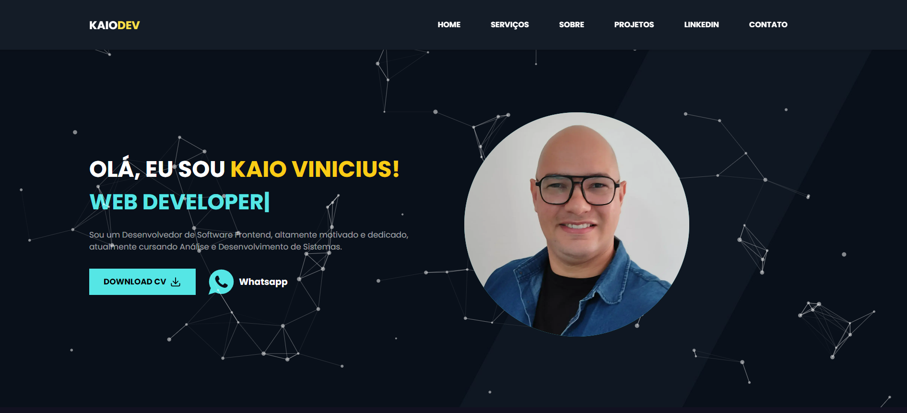
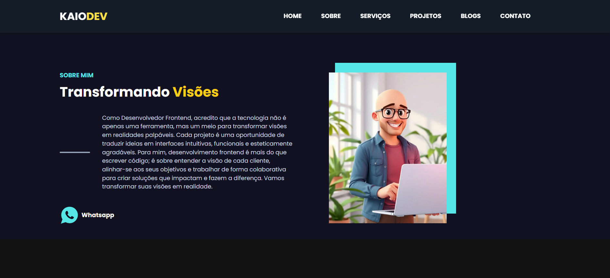
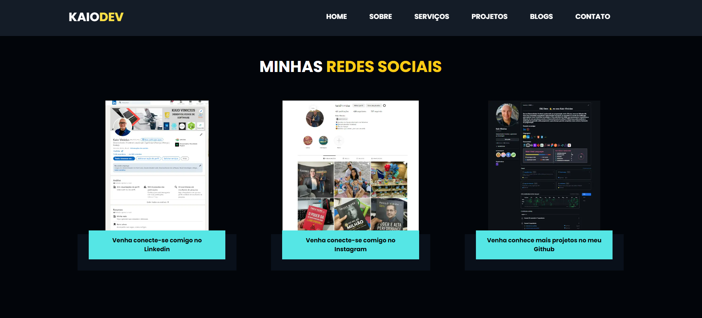
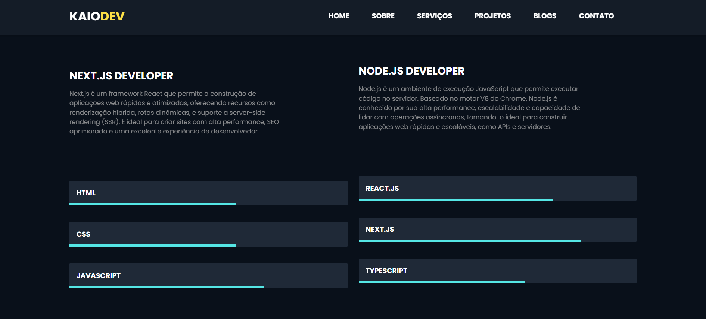

[PROJECT__URL]:https://my-portfolio-xi-eight-43.vercel.app/
[PROJECT__BADGE]: https://img.shields.io/badge/📱Visit_this_project-000?style=for-the-badge&logo=project

<h1 align="center" style="font-weight: bold;">My Portfólio</h1>
<p align="center">
 <a href="#sobre">Sobre</a> • 
 <a href="#layout">Layout</a> • 
  <a href="#tecnologias">Tecnologias utilizadas</a> • 
  <a href="#start">Como executar o projeto</a> •
 <a href="#autor">Autor</a>
</p>

[](https://github.com/kaiovinic/my-portfolio/blob/main/LICENSE)


<p align="center">
  <a href="https://skillicons.dev">
    
  </a>
</p>

<h2 id="sobre" align="center">🎮Sobre o projeto</h2>

[![project][PROJECT__BADGE]][PROJECT__URL]

<p>Bem-vindo ao repositório do meu site de portfólio pessoal! Este projeto exibe minhas habilidades e projetos como desenvolvedor fullstack (especialista em Angular, React/Next.js, Node.js, C#/.NET e Salesforce). Foi construído com Next.js, Tailwind CSS e outras tecnologias modernas da web.</p>

<h2 align="center">📦 Funcionalidades</h2>
<ul>
  <li>Design Responsivo: Otimizado para vários dispositivos e tamanhos de tela.</li>
  <li>Componentes Otimizados: Utilização de Image e Link para otimização de carregamento de imagens e navegação.</li>
  <li>Componentes Interativos: Inclui animações e elementos interativos.</li>
  <li>UI Moderna: Utiliza Tailwind CSS para um visual limpo e moderno.</li>
  <li>Navegação Fácil: Rolagem suave e seções bem organizadas.</li>
</ul>

<h2 align="center" id="layout">Layout</h2>
<p align="center">
    
</p>
<p align="center">
    
</p>
<p align="center">
    
</p>
<p align="center">
    
</p>

<h2 align="center" id="tecnologias">🛠️Tecnologias utilizadas</h2>
<h3>Frontend</h3>
<ul>
  <li>Angular: Plataforma e framework de desenvolvimento para a criação de SPAs corporativas estruturadas.</li>
  <li>TypeScript: Superset do JavaScript que adiciona tipagem estática ao código.</li>
  <li>Next.js & React: Frameworks para desenvolvimento de aplicações web modernas, rápidas e otimizadas para SEO.</li>
  <li>@heroicons/react: Um conjunto de ícones SVG para React.</li>
  <li>react-tsparticles: Biblioteca para criar animações de partículas interativas.</li>
  <li>react-type-animation: Componente React para animação de texto.</li>
  <li>react-scroll: Biblioteca para rolagem suave e navegação em páginas.</li>
  <li>AOS: Biblioteca Animate On Scroll para animações de rolagem.</li>
  <li>react-multi-carousel: Biblioteca para criar carrosséis responsivos e personalizados.</li>
</ul>

<h3>Backend & CRM</h3>
<ul>
  <li>Node.js: Ambiente de execução JavaScript no servidor, ideal para APIs rápidas e escaláveis.</li>
  <li>C# & .NET: Linguagem e ecossistema robusto da Microsoft para APIs RESTful, microsserviços e sistemas backend de alto desempenho.</li>
  <li>Salesforce (Apex & LWC): Customizações, lógica de negócio no lado do servidor e componentes modernos no ecossistema CRM número um do mundo.</li>
</ul>

<h3>Implantação em produção</h3>
<ul>
  <li>Vercel</li>
</ul>

<h2 align="center" id="start">🚀Como executar o projeto</h2>
<h3>Pré-requisitos:</h3>
<ul>
  <li><a href="https://nodejs.org/pt/download/prebuilt-installer">NodeJs</a></li>
</ul>

```bash
# Clonar repositório
git clone https://github.com/kaiovinic/my-portfolio.git

# Instalar dependências
npm install

# Executar o projeto
npm run dev
```

<h2 " align="center">💡Aprendizado</h2>
<p>Este projeto me permitiu aprimorar minhas habilidades em Next.js, React, TypeScript e Tailwind CSS. Aprendi a integrar várias bibliotecas e tecnologias modernas, diversas bibliotecas React para criar uma interface de usuário responsiva e interativa. Trabalhei com a passagem de dados e gerenciamento de estado entre componentes, melhorando a fluidez e a dinâmica da aplicação. Experimentei a personalização de carrosséis e animações, o que ajudou a otimizar o desempenho e a experiência do usuário.</p>

<h2 align="center" id="autor">Autor</h2>
<h3 align="center">Kaio Vinicius</h3>
<p align="center">
  <a href="https://www.linkedin.com/in/kaioviniciussilva/" style="text-decoration: none;">
    
    <br>
    <span style="font-weight: bold; text-decoration: none;">LinkedIn</span>
  </a>
</p>

